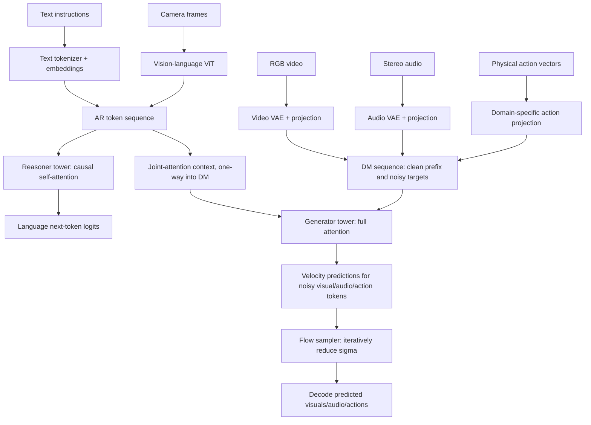

# Cosmos 3: the paper, mathematical model, tensor contract, training and critical review

**Main paper:** [Cosmos 3: Omnimodal World Models for Physical AI](https://research.nvidia.com/labs/cosmos-lab/cosmos3/technical-report.pdf) (NVIDIA, 2026, arXiv:2606.02800). **Primary implementation:** [NVIDIA/cosmos](https://github.com/NVIDIA/cosmos). Section references refer to that technical report.

> Scope: precise exposition of the documented architecture, followed by an annotated **educational approximation**. We do **not** claim that the mini architecture, pretraining, data, or codecs are NVIDIA's actual implementation. The technical report is the authority for model-specific decisions; the source repository is the authority for inference APIs.

## 0. The problem being solved

A physical-AI system needs more than a segmentation model. It can be required to (1) understand a current scene; (2) answer questions; (3) simulate what changes after an intervention; (4) predict which actions connect successive observations; and (5) generate new examples. This mixes **discrete language tokens** and **continuous sensory and motor values**.

Cosmos 3 reconciles these with *two routes inside a unified model*:

- **AR / Reasoner:** receives text and ViT-encoded image/video, with causal token prediction.
- **DM / Generator:** receives clean sensory/motor conditions plus noisy targets, with full attention and flow matching.
- **Dual-stream interaction:** the DM tower can attend to AR states, but AR cannot depend on DM states. This lets text describe the intended outcome while preserving autoregression.

A simplified schematic:



**Important:** In the real Cosmos 3, the AR and DM paths have separate normalization, attention projection and feed-forward parameters; the *attention operation* coordinates them. They are neither two unrelated models manually piped together nor simply one identical set of layers for every token. (Paper §2.3, Fig. 5.)

## 1. Exactly how five modalities become neural-network inputs

### 1.1 Language

Raw input: Unicode text, e.g. `"Camera moves left; predict next two frames and actuator motion."`. A real language tokenizer converts it into discrete IDs `i_j`, which are mapped to continuous vectors via an embedding table `E_text`:

`e_j = E_text[i_j] ∈ R^D`.

With batch dimension `B` and `L` token IDs, the embedding is `[B,L,D]` and the next-token prediction head produces `[B,L,V]`, with `V` vocabulary size. `D` is the model's width; not the number of text characters.

This lab deliberately implements a **character** tokenizer (`tokenizer.py`), with `V=134`, to avoid external model downloads. That is *not* NVIDIA's actual tokenizer.

### 1.2 Image and video *understanding* encoder: ViT

From §2.1.1: 16×16 pixel patches, a two-layer MLP that merges 2×2 patch features, and features aggregated via DeepStack. This path represents observations for reasoning. ViT and the backbone are jointly trained in the paper.

For `[B,T,3,H,W]`, initial 16×16 patches create approximately `T*(H/16)*(W/16)` patch vectors; merging 2×2 reduces the spatial token count approximately four-fold. Irregular resolutions, dynamic patching, exact merging, DeepStack and special tokens make the real token-count bookkeeping more complex than this illustration.

Toy: `VisionUnderstandingEncoder.stem` is a convolution whose kernel=stride=4, so each 16×16 image makes `4*4=16` tokens. `T=3` gives `48` tokens. It does **not** implement the pretrained 16×16 ViT/DeepStack.

### 1.3 Image and video *generation* encoder: video VAE

For generation, §2.1.1 describes the VAE from Wan2.2-TI2V-5B, frozen during backbone training. It compresses video by approximately `4×` in time and `32×32` in space (a learned 16×16 compression followed by 2×2 merging). A projection maps the VAE channels to `D`.

The two visual paths have **different jobs**: understanding benefits from semantic visual features, generation benefits from an invertible/compressible latent space. Putting a raw pixel directly into the MoT would ignore this distinction.

Toy: `ToyVisualCodec` uses a learned 4×4 stride-4 convolution and transposed convolution. It has **no VAE distribution, KL term, temporal compression, pretrained weights, or photorealistic decoder**. We train its reconstruction stage first; only then freeze it for generator training. This deliberate difference keeps the lab runnable on CPU.

Real example (480p, 832×480, 189 frames): spatial latent size is nominally `26×15`, temporal latents roughly `48` (exact padding/codec convention matters); therefore the vision DM representation alone may contain on the order of `48×26×15 = 18,720` visual tokens. This is why physical-AI generation is computationally expensive; the toy uses only 48 vision tokens.

### 1.4 Audio VAE

§2.1.2 uses raw **stereo 48,000-samples/s** audio and a hop of **1,920** samples, producing **25 audio tokens per second**. The VAE is frozen. Audio tokens are then linearly projected to `D`.

In our toy, stereo waveform `[B,2,1280]` at **8,000 Hz**, hop 160, generates `[B,8,8]` latents. These values are explicitly educational and differ from NVIDIA's audio encoder and temporal setup. Their physical-time coordinates are computed from their effective token rate (50 tokens/s for this toy).

### 1.5 Action tokens

Actions are continuous vectors, not English words. §2.1.3 maps diverse domains into a shared action-token width while retaining **domain-specific input and output matrices**. For embodiment `k`:

`z_action = W_in^(k) * normalized_action + b_in^(k)`

`predicted_action = W_out^(k) * hidden + b_out^(k)`

Typical reported domains: camera motion 9D, autonomous vehicle 9D, egocentric motion 57D, single-arm robot 10D, dual-arm robot 20D, humanoid 29D. The 9D motion convention often means **3 translation values + 6 values for rotation**; this should not be mistaken for nine unconstrained physical control motors. For robotics, add gripper/effector states according to the embodiment. The report uses pose changes and a 6D-to-rotation-matrix projection involving SVD. See `action_geometry.py`.

**Never** mix physical action systems without explicit units, frames, bounds, robot/tool calibration, gripper definitions and timestamps. Converting a pose *prediction* to safe actuation is a separate planning/control problem.

## 2. Combining multiple neural-network outputs *in one forward pass*

The key answer to "how does one model accept many inputs at the same time?" is that modalities first share **the same final hidden width**, not the same raw shape.

| Input in our B=2 demo | Before encoder | After modality processing | Into which stream? |
|---|---|---|---|
| Language | `[2,56]` IDs | `[2,56,96]` | AR |
| Video for understanding | `[2,3,3,16,16]` RGB | `[2,48,96]` | AR |
| Video to generate | `[2,3,3,16,16]` RGB | `[2,48,96]` | DM |
| Stereo sound | `[2,2,1280]` samples | `[2,8,96]` | DM |
| Camera actions | `[2,2,9]` real values | `[2,2,96]` | DM |

`[B,L,D]` is a token representation, where `B=number of independent training examples`, `L=number of tokens in *that sequence*`, and `D=shared feature width`. It is **not** true that all sources must have the same number of tokens.

In the demo, AR has `[2,104,96]` (48 camera + 56 text tokens); DM has `[2,58,96]` (48 video + 8 audio + 2 action tokens). This means *one* forward pass can return **three different velocity prediction tensors**:

- vision `[2,48,12]`
- stereo audio `[2,8,8]`
- actions `[2,2,9]`

Notice the output projections return to **modality-native channel counts**. They are not `[B,N,96]` when saved.

The two senses of "multiple inputs" are independent: *multimodal fusion* uses different sources within **one sample**; *minibatching* stacks **B samples**. Cameras do not become separate batch samples unless intentionally modeled that way.

## 3. Packed sequences: AR first, DM second

§2.2 defines the sequence as `[AR prefix, DM prefix]`. The AR prefix typically ends with EOS and a Begin-of-Generation (BOG) marker. In DM, **clean conditioning tokens come before noisy target tokens**, and tokens are arranged by modality (vision, audio, action). Different tasks select which tokens are clean/noisy.

| Task | Clean conditioning | Predicted/noisy targets | Why it matters |
|---|---|---|---|
| Language | text + optional ViT observations | next language IDs | AR-only path |
| Text-to-image | AR text | image latent | spatial image generation |
| Text-to-video | AR text | video latents | temporal generation |
| Text-to-video+sound | AR text | video + audio latents | sound/vision alignment |
| Image-to-video | prompt + first clean frame | next video latents | preserve initial physical state |
| Video-to-video | prompt + clean history | future video latents | continue observed dynamics |
| Video transfer | prompt + clean control video (edge/depth/etc.) | photoreal video latents | structural control |
| Forward dynamics | past vision + actions | future vision | predict effects of intervention |
| Inverse dynamics | observed video transitions | actions | infer interventions |
| Policy / world-action | starting context | future vision **and** future actions | jointly simulate and act |

In the source implementation, `generator_loss(..., mode="...")` builds these clean/noisy segment lists. `mode="all"` denoises video, audio and actions at the same time. `mode="policy"` corresponds to joint future video+action prediction. Be aware: the *semantic* action model also depends on action representation, alignment, training data and embodiment.

## 4. The central MoT attention mechanism

Consider AR query/key/value vectors `Q_AR,K_AR,V_AR` and DM query/key/value vectors `Q_DM,K_DM,V_DM`.

**AR pathway (causal):**

`O_AR = CausalAttention(Q_AR, K_AR, V_AR)`

An AR token may look only at previous AR tokens, never any DM token. This supports next-token reasoning and prevents generation targets from leaking into text supervision.

**DM pathway (bidirectional):**

`O_DM = FullAttention(Q_DM, concat(K_AR,K_DM), concat(V_AR,V_DM))`

DM queries can inspect the entire AR prompt and all DM tokens, including clean historical context and noisy target tokens. The two routes have their own LayerNorm, QKV, output and FFN weights in each layer.

If AR length is 3 and DM length is 2, the **effective** attention matrix is:

```text
keys ->   AR0 AR1 AR2  DM0 DM1
queries
AR0          1   0   0    0   0
AR1          1   1   0    0   0
AR2          1   1   1    0   0
DM0          1   1   1    1   1
DM1          1   1   1    1   1
```

This is **not** full attention across the whole concatenated `[AR;DM]` sequence. The upper-right block is prohibited. Our `DualStreamMoTBlock.forward` performs these two attention computations explicitly with `torch.nn.functional.scaled_dot_product_attention`.

### Important leakage test

`python -m cosmos3_lab.inspect` computes AR logits with three DM inputs, replaces every DM input with random noise, and repeats the call. In evaluation mode the maximum AR difference should be **zero**. The test suite asserts this condition as a regression test.

## 5. Spatial and *physical* temporal coordinates

§2.4 introduces 3D Multimodal RoPE, or MRoPE. Each token has `(t,h,w)` coordinates. A RoPE rotation is applied to Q and K (not V), encoding relative positions through phase differences.

- Text: `t=h=w` = its language position, reducing the three-axis construction to an effective 1D progression.
- RGB/video: time `t` advances with latent frames, while `h,w` index the latent spatial grid.
- Audio: only time varies; `h=w=0`.
- Action: only time varies; `h=w=0`.

**Temporal rate must mean real time.** If a video tokenizer outputs `fps/4` temporal tokens/s and audio outputs `25` tokens/s, raw token indices do not align. The paper sets base TPS to `24/4=6`; for modality rate TPS, step size is:

`delta_t = TPS_base / TPS_modality`.

At video fps=16, the *real* video latent token rate is 16/4=4, therefore `delta_t=6/4=1.5`. For video fps=30, rate=30/4=7.5, therefore `delta_t=6/7.5=.8`. Audio at 25 tokens/s uses `.24` model-time units per token.

A noteworthy engineering nuance is a **temporal gap of 15,000** inserted between AR positions and DM positions. NVIDIA reports it reduces initial-frame oversaturation/checkerboard artifacts when AR and first-frame temporal coordinates are too close. The lab includes this gap exactly as a conceptual demonstration. It does not prove the same image-quality effects at tiny scale.

## 6. Rectified flow: the actual generator training objective

This paper uses **rectified flow matching**, not a plain DDPM epsilon-prediction objective. Let the clean target be `x0`, Gaussian noise `epsilon ~ N(0,I)`, and `sigma` range from 0 (clean) to 1 (noise):

`x_sigma = (1-sigma) * x0 + sigma * epsilon`

The derivative with respect to `sigma` is the constant **velocity**:

`v_star = epsilon - x0`.

The denoiser `v_theta(x_sigma, sigma, conditioning)` is trained with masked MSE on noisy targets:

`L_DM = (1 / N_noisy) * sum_{i in noisy tokens} ||v_theta_i - (epsilon_i - x0_i)||²`.

The **clean conditioning tokens are not denoised** and contribute no diffusion loss. Their values guide the denoising of target tokens. In our code, the `targets` dictionary includes only noised segment names; clean segments are excluded from the loss computation.

The paper uses *per-modality* noise-time sampling, including logit-normal and special video-mode sampling, and a noise shift:

`sigma = s * t_bar / (1 + (s-1) * t_bar)` with `t_bar = 1 - t`.

The lab uses logit-normal sampling with a shift helper. It does **not** reproduce NVIDIA's specialized video-mode sampling or long-sequence training curriculum.

### Why a single model can generate several outputs

At one step, the model receives **noised video latents, noised audio latents, and noised action latents together** (plus clean conditioning and text). The DM tower outputs separate velocity predictions `v_video`, `v_audio`, `v_action`, conditioned on one another through bidirectional attention. With `sigma_next < sigma_current`, each output is updated:

`x_next = x_current + (sigma_next - sigma_current) * v_pred`.

Iterate until `sigma=0`. `sample_joint` implements a simple Euler sampler. In full Cosmos 3, samplers, rate-specific noise schedules, latents, guidance and caching require careful tuning.

### Classifier-free guidance

To strengthen conditioning, train sometimes with text removed; then combine conditional/unconditional velocities:

`v_guided = v_uncond + guidance_scale * (v_cond - v_uncond)`.

The toy implements optional guidance in `sampling.py` and randomly removes text 10% of the time in `generator_loss`. It is **not** NVIDIA's production CFG, where different negative prompts and modality-dependent guidance strategies are tested.

## 7. Discrete reasoning loss and the AR training path

AR training uses teacher-forced next-token cross-entropy. With hidden states `h_i` and token head `W_vocab`, the conditional probability of token `i+1` is:

`p(y_(i+1)|y_(<=i), vision) = softmax(W_vocab * h_i)`.

One way to fine-tune for defect reasoning is to encode an image or video **before the question tokens**, append an answer separator, and then train only on the answer portion:

`[ViT tokens | BOS | "Does this part show a defect?" | SEP | "yes" | EOS]`.

In our `answer_batch` the labels of prompt positions are `-100`, which PyTorch `cross_entropy(ignore_index=-100)` excludes. This is the principle of *assistant-only loss masking* for an instruction-following reasoner.

Caution: a toy label such as yes/no is **not** sufficient for robust visual reasoning. A reliable real task would also need defect localization, class ontology, uncertainty calibration, lighting/domain shift tests, and industrial ground truth.

## 8. Training pipeline in the paper versus this lab

**Paper:** Reasoner initialization from existing VLMs (Edge uses internal model, Nano Qwen3-VL-8B, Super a larger VLM lineage), followed by multimodal pretraining and specialized SFT. Generator training starts from the reasoner / VLM weights and progresses through pretraining, mid-training with richer Physical AI datasets, and task-specific post-training, including T2I, I2V and robot policies. Vision understanding is jointly trainable; visual/audio generation VAEs are frozen.

**Lab:**

1. Train toy video/audio codecs for basic reconstruction.
2. Train a randomly initialized toy reasoner on the synthetic defect-answer task.
3. Train generator projection, time embeddings and MoT blocks on rectified-flow losses over synthetic trajectories.
4. Test all modes and run a simple Euler sampler.

There are two fundamental omissions in our lab: (a) **pretrained VLM alignment**; (b) **pretrained high-fidelity multimodal VAEs**. These are not minor details. Without them, good generated movies or useful defect recognition should not be expected from a small training run.

## 9. What to measure instead of relying on attractive generated videos

- **Code correctness:** tensor shapes, domain dimensions, encoder/decoder consistency, AR-causal invariance, no cross-example information leakage, sigma endpoints.
- **Reasoner:** answer accuracy, per-defect precision/recall, negative controls, calibrated confidence, temporal anomaly recognition.
- **Visual generation:** conditional fidelity, temporal motion consistency, VBench/PAI-style quality and physical plausibility, deformation and object permanence.
- **Audio:** semantic match to visual events, onset alignment, spectral quality and channel coherence.
- **Action:** trajectory error in appropriate units, rotation SO(3) validity, grasp metrics, success rate in simulation, rollout stability, safety violations.
- **Industrial deployment:** false-accept rate, false-reject rate, latency p50/p95/p99, camera triggering, input drop rate, OOD/novel-defect detection, safety interlocks and human override.

Our `evaluate.py` reports held-out *synthetic losses only*. It is a software verification exercise, not a claim of physical plausibility.

## 10. Paper nuances, limitations and research questions

1. **MoT is not mixture-of-experts routing.** Here it means two transformer pathways specialized for AR/DM processing and one-way shared-attention interaction.
2. **Reasoning and generation aren't the same loss.** Language CE and latent flow MSE optimize different statistical quantities.
3. **Two visual encoders are intentional.** ViT understanding and VAE generation differ in representational semantics and training/freeze behavior.
4. **Action is not just an output head.** It has its own modality-specific tokens, losses, projection matrices and physical-time alignment.
5. **Noisy and clean tokens have different supervision.** Conditioning tokens can participate in attention while being excluded from flow loss.
6. **The diffusion branch is bidirectional, not time-causal.** Appropriate for offline denoising and conditional generation, not automatically a causal online policy guarantee.
7. **Temporal conditioning differs from action conditioning.** Pure video prediction may exploit dataset correlations but fail under counterfactual interventions; evaluate action-conditioned causality independently.
8. **Multi-camera is not simple temporal stacking.** Calibrated camera views need a view ID, extrinsics/intrinsics, synchronization, and treatment of occlusions. NVIDIA's specialized driving simulations have multimodal camera/LiDAR capabilities beyond this toy's single camera stream.
9. **Long videos are expensive.** Attention grows quadratically with token count absent optimized kernels/distributed context attention, and decoding has separate latency/memory costs.
10. **Generated physics is learned, not guaranteed.** Visual plausibility does not prove conservation laws, collision correctness or safe robot behavior.
11. **High-resolution scratch inspection is a different bottleneck.** Compression and downsampling can erase the small defect that matters most in industrial visual inspection; consider high-resolution patch/hierarchical specialists alongside a world model.
12. **RL is an extension, not automatic.** To combine a world model with PPO/GRPO or other RL methods, define trustworthy reward, robust rollout model, observation/action alignment, policy update and uncertainty constraints.

## 11. Recommended research ablations

| Experiment | Change | Test the hypothesis |
|---|---|---|
| Visual dual-encoder | ViT vs. VAE features for AR | Better semantic understanding vs. reconstruction |
| Joint attention | Remove AR→DM context | Language grounding of generated trajectories |
| Per-modality time | Replace physical timestamps with token indices | Audio/visual/action temporal desynchronization |
| Motion conditioning | Remove clean actions during forward dynamics | Effect of interventions versus visual priors |
| Unconditional score | Turn CFG off | Text fidelity versus diversity/quality |
| Action normalization | Compare per-embodiment normalization | Cross-domain action-scale stability |
| DM context | Remove clean initial frames | Drift in image-to-video |
| Loss masking | Erroneously penalize clean tokens | Prediction degradation / target leakage |
| Geometry | Compare 6D rotation postprocessing | Orthonormality and trajectory feasibility |
| Industrial domain | Add high-resolution defect patch path | Small-defect recall versus compute |

**For a PhD-quality study**, freeze dataset splits across experiments, keep identical seeds/compute budgets, report uncertainty across multiple seeds and audit train/test leakage at the trajectory/physical-object level.
